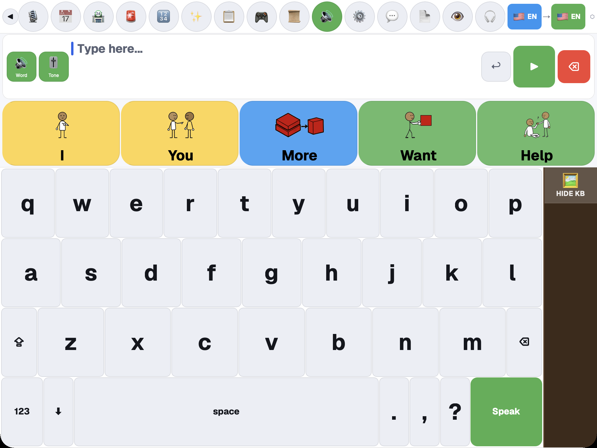
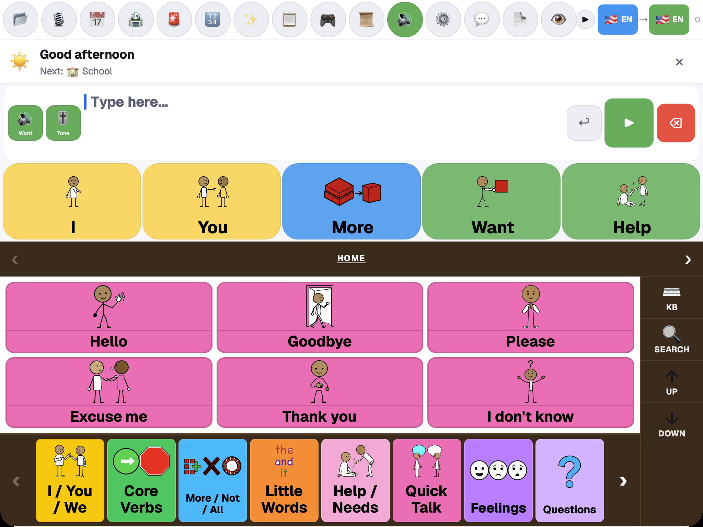
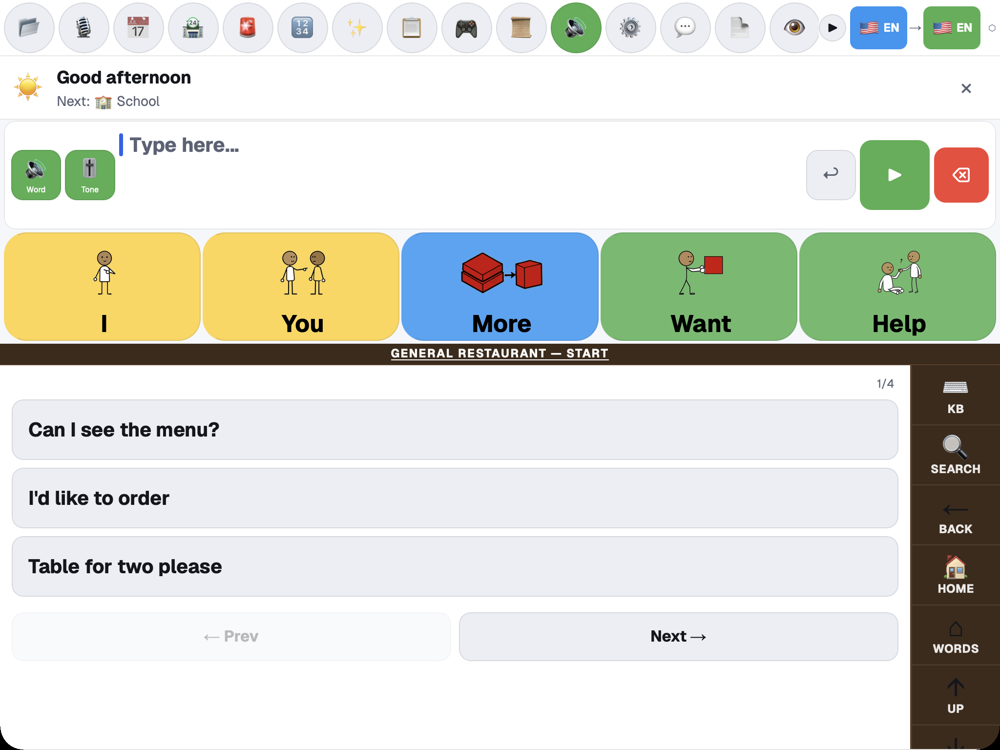
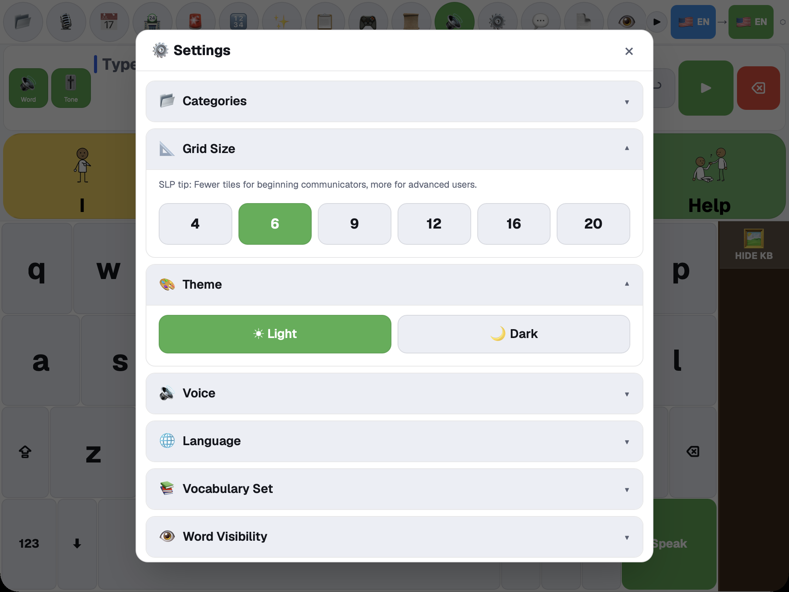

# Prism AAC

An augmentative and alternative communication (AAC) app for people who communicate with pictures, phrase boards, typing, speech output, or alternative input such as switches and head tracking.

Use it on iPhone, iPad and Apple Watch from the [App Store](https://apps.apple.com/app/id6764692277), or in a web browser at [synalux.ai/prism-aac](https://synalux.ai/prism-aac).

## A subscription app since November 19, 2026

Prism AAC is a subscription app, with a 2-week free trial for new subscribers. Without a subscription, the app opens to a screen to start the trial, subscribe or sign in. [View current plans](https://synalux.ai/pricing).

Emergency communication, crisis phrases and bedside cards always stay free, with or without a subscription. If a subscription ends, your saved boards and phrases are not deleted.

## Build a message and speak it

Tap pictures or type words to build a message, then select **Speak**. Prediction tiles offer the next word, so a message can be built without finishing each word by hand. Separate input and output language buttons let you type in one language and speak in another where translation is available.

## Phrase boards for everyday situations

Select **Categories** for core words, quick talk, help and needs, feelings, questions, people, food and drink, places and more. Some categories contain guided phrase sequences for a real situation, such as ordering at a restaurant; use **Next** and **Prev** to move through them.

  
  

## Access that fits the communicator

Open **Settings → Accessibility & Input Modes** to set up switch scanning, head tracking with dwell selection, gestures, camera finger tracking, high contrast and spoken feedback. Camera-based controls ask for camera permission first. Calibrate with the communicator, and keep a reliable touch backup.

## More in the app

The toolbar opens **Schedule** for visual routines, **Send a message** to contacts and caregivers, **Notes**, **History**, a **Math** workspace, **Games**, the **Marketplace**, a **PDF reader**, a **Screenshot reader** and the **Comfort Player**. The **Alert** button opens a confirmation step before it notifies a configured caregiver. Caregivers can protect Settings with a PIN.

Read the [Prism AAC user guide](docs_source_en/prism_aac.md) for the full workflow: every module, alternative input, offline use, settings, privacy and first-time setup.

The App Store app needs **iOS 16 or later**; the Apple Watch app needs **watchOS 10 or later**. The web app runs in a current browser. Labels in this guide are in English; other app languages may differ.

Prism AAC supports communication; it does not replace a qualified clinician's assessment or an emergency call system. Keep a backup way to communicate. See the [Privacy Policy](https://synalux.ai/legal/privacy).
