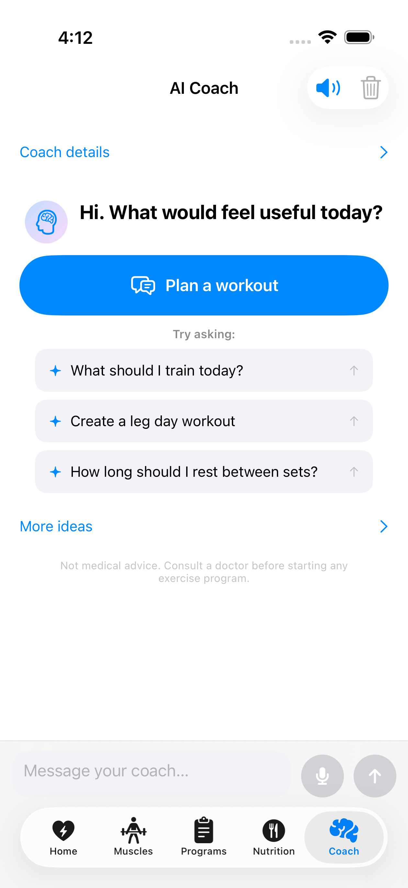
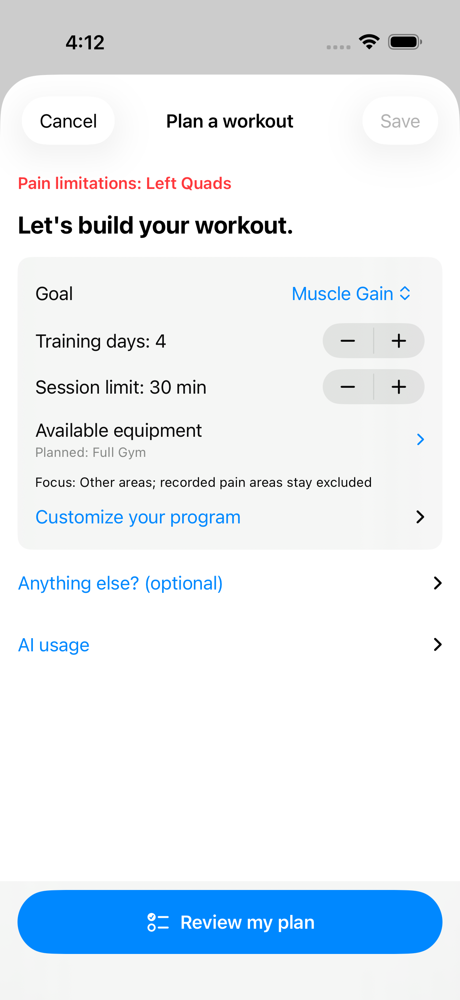
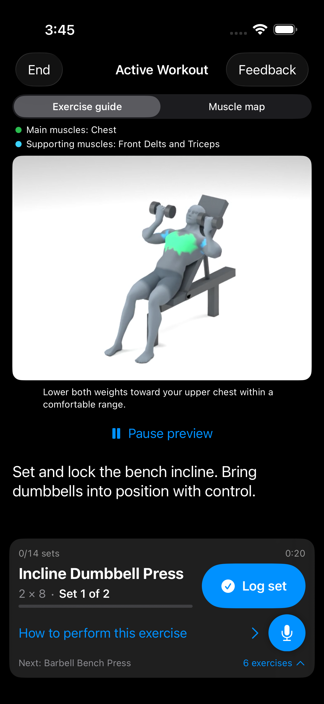
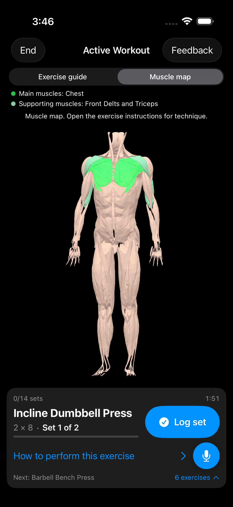
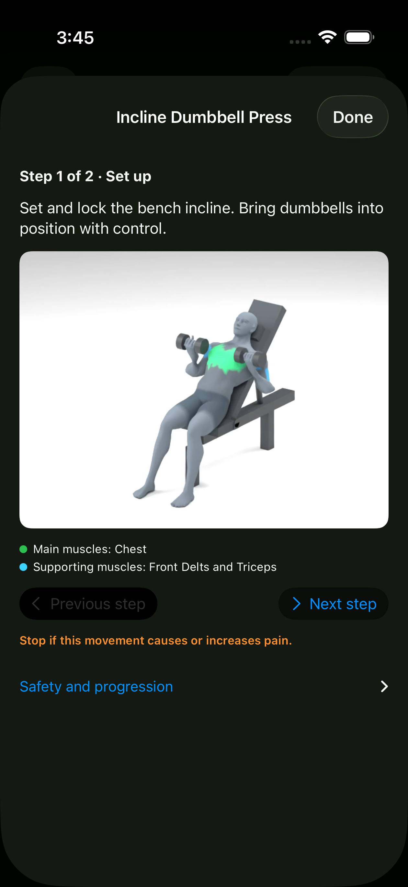
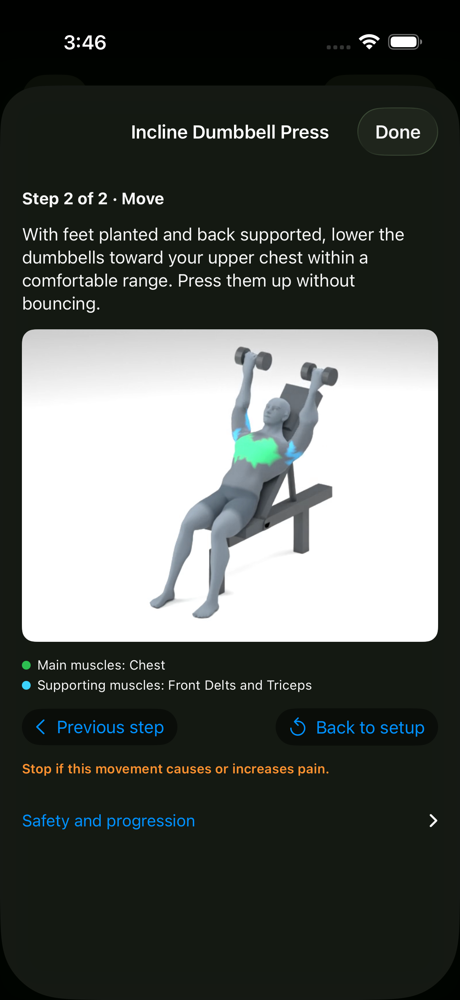
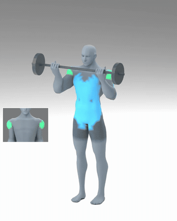

# PrismCoach

A fitness coach for planning a workout, understanding each movement, and recording your progress.

**[Download PrismCoach on the App Store](https://apps.apple.com/app/id6778001709)** for iPhone and iPad. On a Mac with Apple silicon, the App Store installs the iPad version.

> **Screenshots updated November 14, 2026.** The screenshots in this guide are from PrismCoach's App Store listing and were captured on an earlier build, so a few screens differ in the current version (1.2.14). For example, the workout screen's **Feedback** button is now **Rate & finish**, and on iPhone the workout card on the Exercise guide tab shows **Details**, which expands it to reach **How to perform this exercise**. Your screens also depend on your own goals, equipment and recorded limitations.

## Start with your coach

Open **Coach → Plan a workout**, or choose a suggested question. Tell the coach your goal, available time and equipment, and any pain or movement limits. You can use the visible choices without writing a long prompt; typing and voice input are optional ways to add detail.

**Free users can explore AI coaching with recurring allowances.** Pro provides higher allowances and additional access. Check the allowance and subscription screens in the app for current availability and Apple's purchase terms.

  
  

## Review your plan, then train

Review the goal, schedule, equipment and exercises before saving. If the app asks for a review, open the flagged item and check the reason before starting. A pain selection remains a limitation until you explicitly resolve it; clearing training focus does not clear pain.

The review shows the next item that needs attention and an action to address it. You can expand the full list when needed. Once your choices are ready, **Confirm and Generate** continues planning.

During a workout:

- **Exercise guide** shows the available movement demonstration, including its equipment. Use its play/pause control to choose when it moves. With **Auto-Play Video Previews** turned off in iOS Settings, it starts with still pictures and you can still choose **Play preview**.
- The muscle-role legend identifies the main and supporting muscles. Its labels explain the colors; the highlights are illustrative, not a measurement of muscle activation.
- On the compact workout card, open **Details**, then **How to perform this exercise** for illustrated steps with written instructions; in other layouts the link is already on the card. Use **Next step**, **Previous step**, and **Back to setup** at your own pace.
- **Muscle map** opens the separate anatomical view. Use the exercise guide for technique.
- **Log set** opens the actual-set entry. Use the on-screen number controls, then **Log performed set** to save what you did. Playing or pausing a preview does not log a set.

  
  

*These workout screens are from an earlier build. In 1.2.14 the top-right button reads **Rate & finish**, and on iPhone the Exercise guide tab's card shows **Details** first.*

  
  

  
See an equipment movement example

  

*The animation is an example of the app's demonstration media. Screenshots are actual app captures. Availability depends on the exercise; this does not promise an animation for every possible exercise.*

## More in the app

Use **Home** for your next workout and available readiness information, **Muscles** for training focus and pain context, **Programs** for saved plans and templates, and **Nutrition** for meal logging. The optional Apple Watch companion, voice and music controls depend on device support, permissions and availability shown in the app.

Read the [PrismCoach user guide](docs_source_en/prismcoach.md) for the full workflow, screenshots, equipment and camera choices, purchases, privacy and troubleshooting.

PrismCoach requires **iOS 18 or iPadOS 18 or later**, or **macOS 15 or later on a Mac with an Apple M1 chip or later**. English labels are used in this guide; labels in other app languages may differ.

PrismCoach provides general fitness information. AI suggestions, recovery estimates and demonstrations do not establish whether a movement is suitable for an injury or medical condition. Stop a movement if it causes or increases pain. See the [Privacy Policy](https://synalux.ai/legal/privacy) and the in-app safety information.
