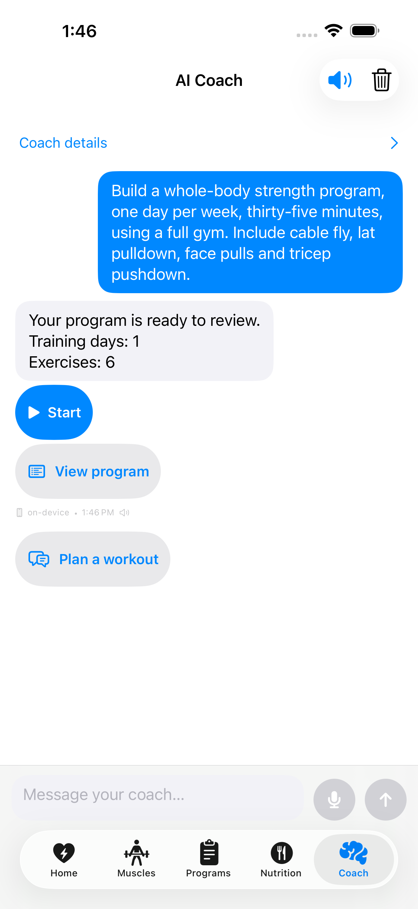
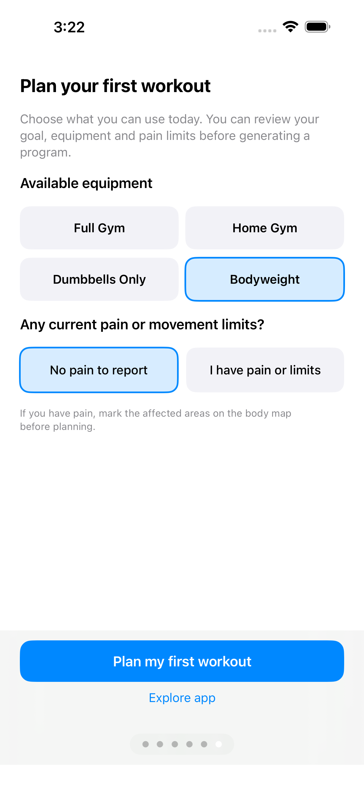
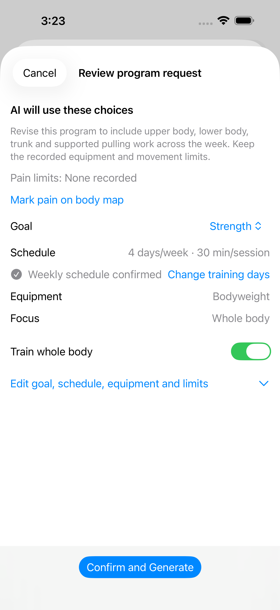
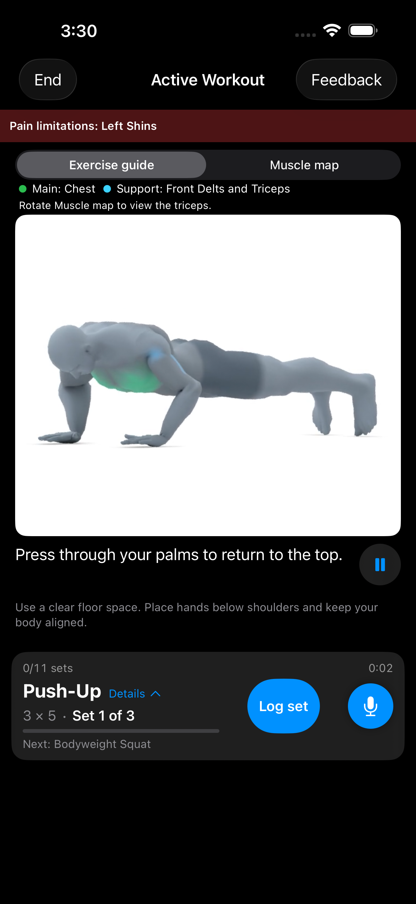
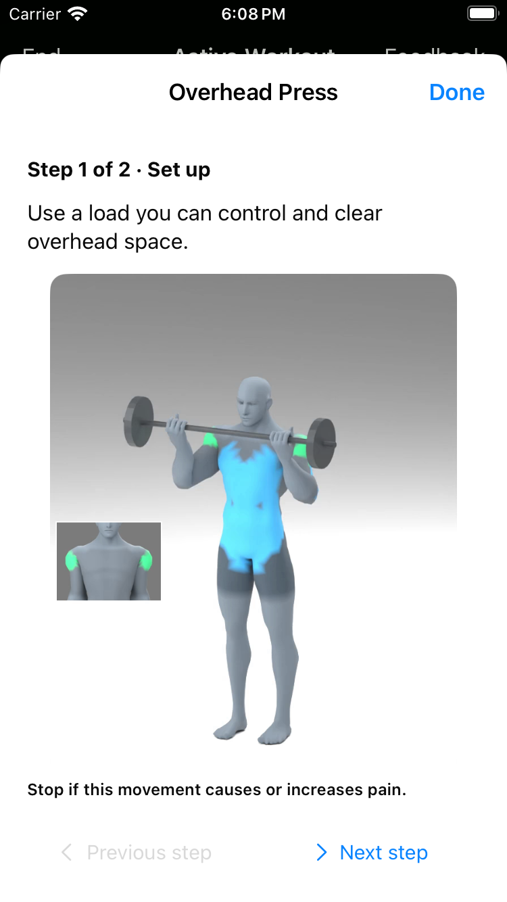
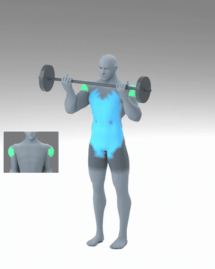

# PrismCoach

A fitness coach for planning a workout, understanding each movement, and recording your progress.

> **Development preview — updated October 26, 2026.** Actual app captures from October 25–26 show the unreleased interface in the simulator with demonstration data. The App Store version may differ. This preview does not announce a release.

## Start with your coach

Open **Coach → Plan a workout**, or choose a suggested question. Tell the coach your goal, available time and equipment, and any pain or movement limits. You can use the visible choices without writing a long prompt; typing and voice input are optional ways to add detail.

**Free users can explore AI coaching with recurring allowances.** Pro provides higher allowances and additional access. Check the allowance and subscription screens in the app for current availability and Apple's purchase terms.

  
  

## Review your plan, then train

Review the goal, schedule, equipment and exercises before saving. If the app asks for a review, open the flagged item and check the reason before starting. A pain selection remains a limitation until you explicitly resolve it; clearing training focus does not clear pain.

The review shows the next item that needs attention and an action to address it. You can expand the full list when needed. Once your choices are ready, **Confirm and Generate** continues planning.

During a workout:

- **Exercise guide** shows the available movement demonstration, including its equipment. Use its play/pause control to choose when it moves. With Reduce Motion enabled, you can still choose **Play preview**.
- The muscle-role legend identifies the main and supporting muscles. Its labels explain the colors; the highlights are illustrative, not a measurement of muscle activation.
- On the compact workout card, open **Details**, then **How to perform this exercise** for illustrated steps with written instructions. Use **Next step**, **Previous step**, and **Back to setup** at your own pace.
- **Muscle map** opens the separate anatomical view. Use the exercise guide for technique.
- **Log set** opens the actual-set entry. Use the on-screen number controls, then **Log performed set** to save what you did. Playing or pausing a preview does not log a set.

  
  

  
See an equipment movement example

  

*The animation is an example of the app's demonstration media. Screenshots are actual app captures. Availability depends on the exercise; this does not promise an animation for every possible exercise.*

## More in the app

Use **Home** for your next workout and available readiness information, **Muscles** for training focus and pain context, **Programs** for saved plans and templates, and **Nutrition** for meal logging. The optional Apple Watch companion, voice and music controls depend on device support, permissions and availability shown in the app.

Read the [PrismCoach user guide](docs_source_en/prismcoach.md) for the full workflow, current screenshots, equipment and camera choices, purchases, privacy and troubleshooting.

The iPhone candidate requires **iOS 18 or later**. English labels are used in this guide; labels in other app languages may differ.

PrismCoach provides general fitness information. AI suggestions, recovery estimates and demonstrations do not establish whether a movement is suitable for an injury or medical condition. Stop a movement if it causes or increases pain. See the [Privacy Policy](https://synalux.ai/legal/privacy) and the in-app safety information.
