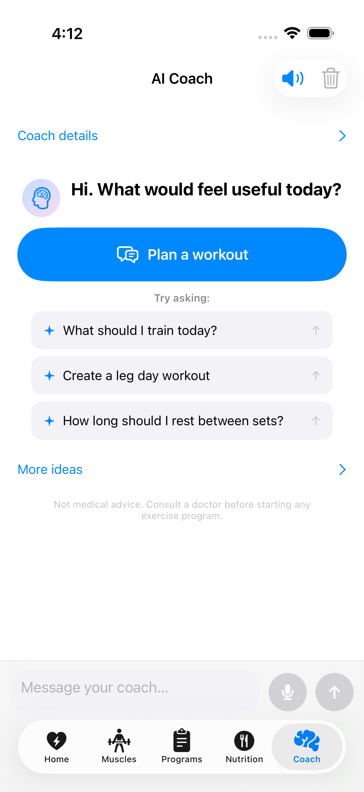
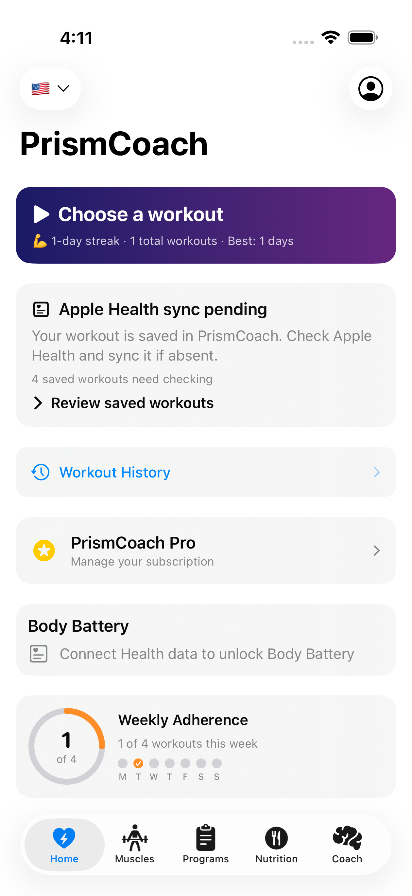
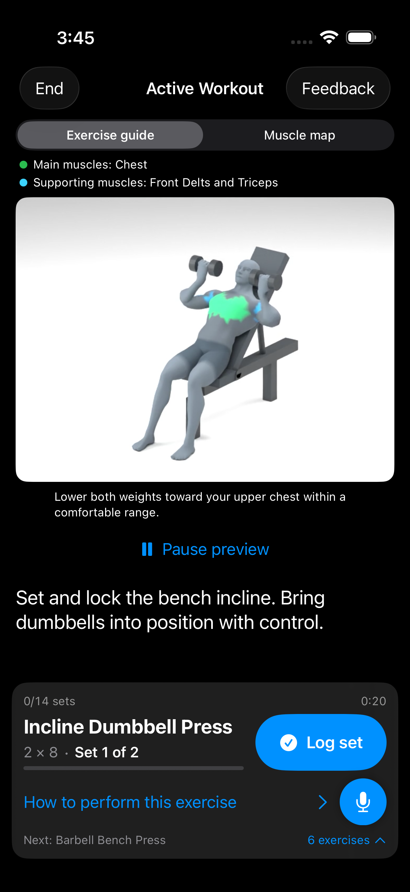
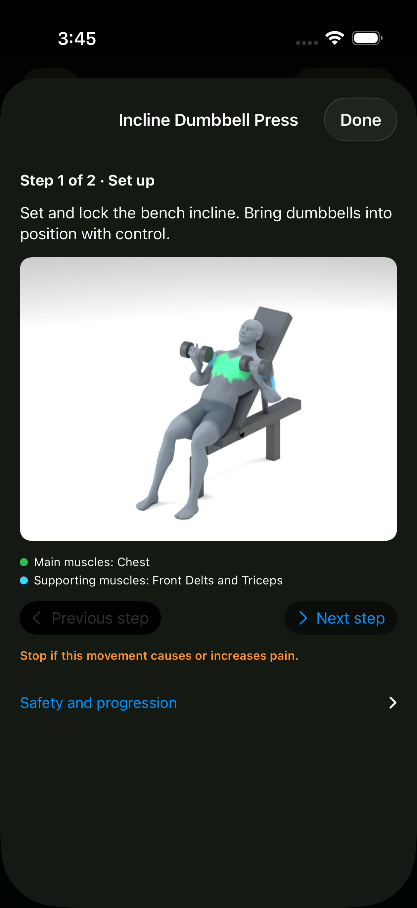

# PrismCoach

A fitness coach for planning a workout, understanding each movement, and recording your progress.

> **Release preview — updated October 20, 2026.** The screenshots below show the unreleased 1.2.9 (86) iPhone candidate on iOS 26.5, captured in the simulator with demonstration data. They are actual app captures, not design mockups. The App Store version may look different. This preview does not announce a release.

## Start with your coach

Open **Coach → Plan a workout**, or choose a suggested question. Tell the coach your goal, available time and equipment, and any pain or movement limits. You can use the visible choices without writing a long prompt; typing and voice input are optional ways to add detail.

**Free users can explore AI coaching with recurring allowances.** Pro provides higher allowances and additional access. Check the allowance and subscription screens in the app for current availability and Apple's purchase terms.

  
  

## Review your plan, then train

Review the goal, schedule, equipment and exercises before saving. If the app asks for a review, open the flagged item and check the reason before starting. A pain selection remains a limitation until you explicitly resolve it; clearing training focus does not clear pain.

During a workout:

- **Exercise guide** plays the available movement demonstration, including its equipment. **Play preview / Pause preview** controls playback.
- **Main muscles** and **Supporting muscles** identify the roles represented by the highlights. The labels explain the colors; the highlights are illustrative, not a measurement of muscle activation.
- **How to perform this exercise** opens illustrated steps with written instructions. Use **Next step**, **Previous step**, and **Back to setup** at your own pace.
- **Muscle map** opens the separate anatomical view. Use the exercise guide for technique.
- **Log set** records a set. Playing or pausing a preview does not log a set.

  
  

*These images show one exercise in the release candidate. Demonstration availability depends on the exercise; they do not imply that every exercise has an animation.*

## More in the app

Use **Home** for your next workout and available readiness information, **Muscles** for training focus and pain context, **Programs** for saved plans and templates, and **Nutrition** for meal logging. The optional Apple Watch companion, voice and music controls depend on device support, permissions and availability shown in the app.

Read the [PrismCoach user guide](docs_source_en/prismcoach.md) for the full workflow, current screenshots, equipment and camera choices, purchases, privacy and troubleshooting.

The iPhone release candidate requires **iOS 18 or later**. English labels are used in this guide; labels in other app languages may differ.

PrismCoach provides general fitness information. AI suggestions, recovery estimates and demonstrations do not establish whether a movement is suitable for an injury or medical condition. Stop a movement if it causes or increases pain. See the [Privacy Policy](https://synalux.ai/legal/privacy) and the in-app safety information.
