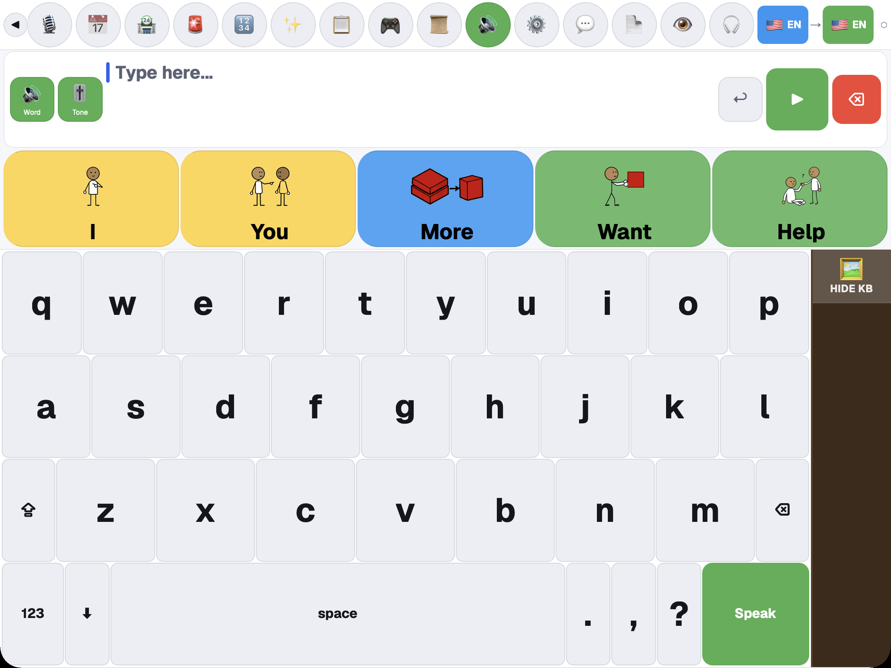
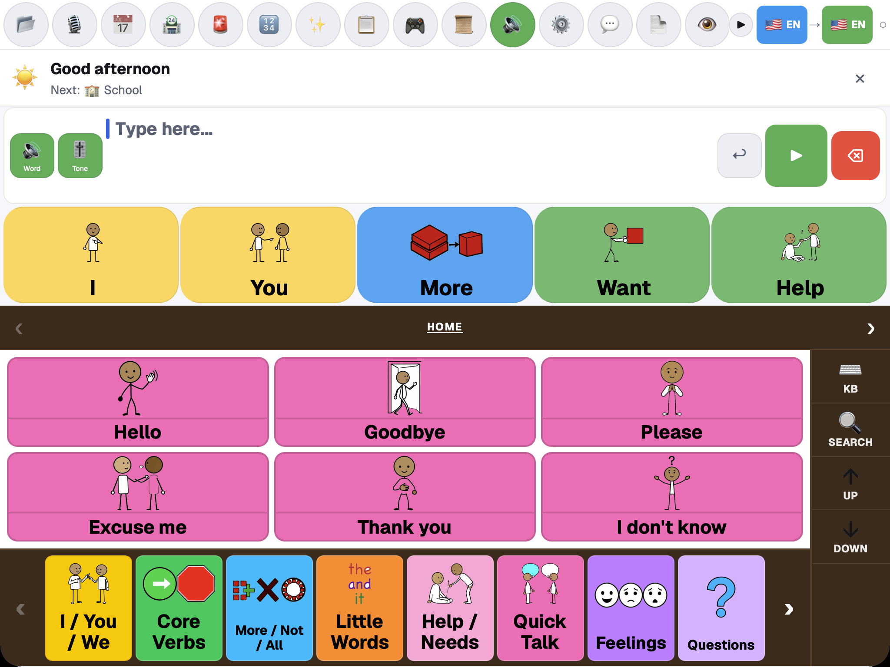
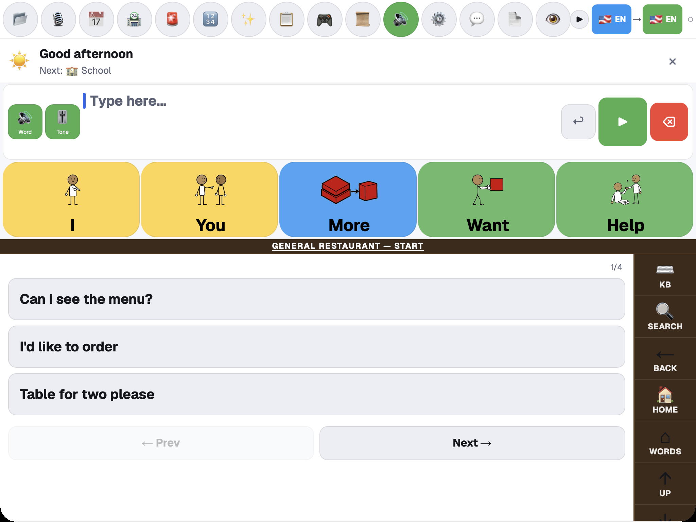
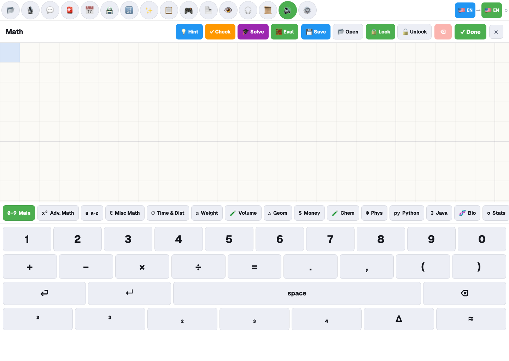
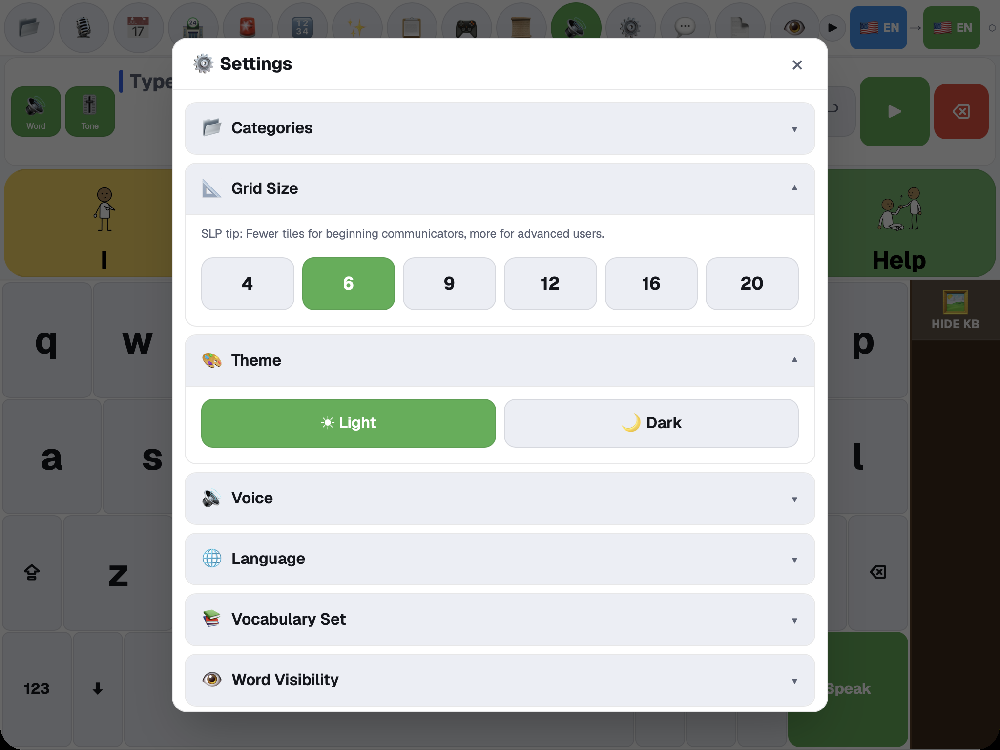

# Prism AAC

Prism AAC is an augmentative and alternative communication workspace for people who communicate with pictograms, phrase boards, typing, speech output, or alternative input methods.

- [Open the web app](https://synalux.ai/prism-aac)
- [Get the iPhone and iPad app on the App Store](https://apps.apple.com/app/id6764692277)
- [View current plans](https://synalux.ai/pricing)

## Plans are changing

The next app update, version 1.9.4, makes Prism AAC a subscription app, with a 2-week free trial for new subscribers. The change starts 14 days after the update is released. When you are signed in, the app shows you the date in advance. Until then, everything works as it does today. [View current plans](https://synalux.ai/pricing).

- Emergency communication, crisis phrases and bedside cards always stay free, with or without a subscription.
- Subscribe in the iPhone or iPad app with your Apple Account, or in the web app. The subscription is linked to your free Synalux account, so it works on iPhone, iPad and the web when you sign in with the same account.
- If a subscription ends, your saved boards and phrases are not deleted.
- New in 1.9.4: "Sign in with Google" in the iPhone and iPad app, next to "Sign in with Apple".
- Manage or cancel the subscription in your Apple Account settings. You can delete your Synalux account at any time in **Settings → Synalux Account → Delete account**.

## Video overview for BCBAs and caregivers

[Watch the Prism AAC overview on YouTube](https://www.youtube.com/watch?v=E6yL0QgmmMk) — 3 minutes 25 seconds, with English narration and captions. The video introduces communication boards, personalization, access options, everyday routines, and caregiver tools using the production app in Safari.

The controls available on a device can vary by browser, operating system, permissions, account, installed modules, and plan.

## Apps and devices

Prism AAC runs in a web browser, as an iPhone and iPad app, and as an Apple Watch app. Boards, phrases and settings are saved on each device. Sign in with the same Synalux account to use your account features on every device.

### iPhone and iPad

- The first time you open the app, an **On-Device AI** screen explains how AI is used. Choose **Continue**, or choose **Continue without AI**. Core communication works without AI. This choice cannot be changed in Settings; to change it, the app has to be reinstalled.
- On a device with enough free memory, the app can run an AI model on the device itself. The first time, the app may need to download that model, so connect to Wi-Fi first. If the model is not available, AI features use cloud AI when you are signed in.
- Press and hold the app icon on the Home Screen for quick actions: **Help**, **Yes**, **No** and **Water please**. Choosing one speaks the phrase with the device voice.

### Apple Watch

The picture cards work on the watch by itself. Sending an alert or a message to a caregiver needs the paired iPhone: the **Alert** and **Message…** buttons and the emergency cards all go through it. If the iPhone is not connected, an emergency card still speaks and vibrates, but the alert is not delivered (see below).

- The watch shows picture cards in two columns. **Yes** and **No** come first. Scroll for more. Tap a card to hear it.
- A bar at the top has four buttons: the language button, **AI** (opens AI Chat), the bell (**Notifications**, with a count of unread messages from caregivers) and the paper plane (opens **Send to caregiver**).
- **Send to caregiver** offers **Alert** (a quick SOS) or **Message…** (write your own). **Alert** goes through the paired iPhone. If the iPhone is not connected, the watch shows "Phone not connected".
- Emergency cards, such as **Help**, first ask **Send Emergency?** After you confirm, the watch speaks, vibrates and shows a red countdown screen. An emergency card cannot be cancelled once confirmed.
- The screen shows "HELP COMING" once the alert is delivered. If it could not be delivered, the screen keeps showing "SENDING…", a **Force Close** button appears, and the watch says "Emergency. Please call 911." Call emergency services yourself if the person is in danger.
- If an AI question fails because the watch is offline, a banner such as "Offline — phrase buttons only" appears. The phrase cards keep working with the phrases built into the watch app.

### Chrome extension

The **PrismAAC Reading Assistant** extension adds speech to text fields on other websites. Search for "PrismAAC Reading Assistant" in the Chrome Web Store to install it. See "Chrome extension: Reading Assistant" below.

## Communication board at a glance

The main board keeps the communication path visible:

- a message bar for the sentence being built;
- Undo, Speak, and Delete actions;
- pictogram prediction tiles;
- an on-screen keyboard;
- input and output language selectors;
- optional Echo and Tone controls;
- a persistent Speak action.

Tap pictograms or type words to build the message, then select **Speak**. The exact speech voice depends on the selected language and the voices available through the current device and configured services.

As the message is spoken, each word is highlighted in yellow in the message bar.

The **↩** button undoes the last change. Tap the red delete button to delete the last word. Press and hold it for about a second and a half to clear the whole message.

The **Mic** button on the toolbar lets you dictate. Your words appear in the message bar as you speak. If the microphone is blocked or missing, the app tells you.

**Sound on** and **Sound off** is a master mute. Turning sound off also stops any speech that is playing.

A new install shows these toolbar buttons: **Categories**, **Mic**, **Send a message**, **Alert**, **Sound** and **Settings**. A caregiver can show the others, and change the order, in **Settings → Toolbar Buttons**. On touch devices the main buttons stay on the toolbar and the others are in the **…** menu.

## Categories and phrase boards

Select **Categories** from the toolbar to open the phrase board. The current board includes core words, quick talk, help and needs, feelings, questions, actions, people, food and drink, places, school or work, health and body, time, and other vocabulary groups.

Use the controls on the right to show the keyboard, search, move through the board, or return home. The category strip provides direct movement between vocabulary groups.

Prism AAC has two layouts: the phrase board with pictures, and the keyboard. Select **KB** to show the keyboard. Select **Hide KB** to go back to the pictures. **Search** looks through all vocabulary.

When a category has more tiles than fit on the screen, swipe left or right to change pages. You can also use the **‹** and **›** arrows at the edges. Swiping to a new page does not select a word. Tap a tile to select it.

Caregivers can open **Settings → Categories → Open Category Manager** to manage board categories. Category visibility and the selected grid size affect how much vocabulary appears at once; choose a layout that the communicator can target reliably.

Grid sizes are 4, 6, 9, 12, 16 and 20 tiles. Fewer tiles suit beginning communicators.

## Real-world scenarios

Some categories contain guided phrase sequences for common activities. In **Food & Drink**, for example, the current General Restaurant sequence starts with phrases such as “Can I see the menu?”, “I’d like to order,” and “Table for two please.”

Use **Next** and **Prev** to move through a sequence. Available scenario packs can change with the installed vocabulary and marketplace modules, so review the actual phrases before relying on a board in a new setting.

## Keyboard, prediction, and languages

The keyboard supports direct typing alongside the pictogram board. Prediction tiles can be selected without finishing a word manually.

Two optional settings in **Settings → Accessibility & Input Modes** add spoken feedback. **Speak each selection** says each word or picture you choose, to confirm it. Your message is only spoken when you press Speak. **Speak each sentence** speaks the finished sentence when you type . ? or !. The Echo button in the message bar switches between these two modes and off.

The toolbar exposes separate input and output languages where translation is available. Confirm both language buttons before speaking a translated message. Translation, assisted correction, and some prediction paths may require an account, a configured model, or a network connection; the keyboard and stored board remain the fallback communication path.

For Amharic, Swahili and Bengali, no native speaker has checked the translations yet. Core and safety words always appear. The other words are hidden unless a caregiver turns on **Show unreviewed words** in **Settings → Language**.

## Pictures on prediction tiles

Prediction tiles show the built-in picture for words in Prism AAC's vocabulary. For other words, signed-in accounts with Synalux Enterprise or a Prism AAC cloud subscription can get a generated picture (for now, Synalux Standard and Advanced accounts can too). Every generated picture must pass an automatic check that it shows the word's meaning; when no picture passes, the tile shows the word as text. Generated pictures are shared by meaning, so the same word in another language can show the same picture.

Review pictures with the communicator, especially for abstract words such as "already" or "maybe": these are learned symbols, not pictures a new reader is expected to guess.

## AI Autocorrect and shared word suggestions

AI Autocorrect is on by default (**Settings → Accessibility & Input Modes → AI Autocorrect**). When you are signed in, the text being typed is sent to Synalux and processed by Google Gemini to suggest corrections and word completions; if a local AI model is connected in Settings, that model is tried first. Dictated text is corrected the same way whenever you are signed in, even with AI Autocorrect off; sign out to stop that.

After **Speak**, words from the message that are not in Prism AAC's built-in dictionaries are sent to Synalux to help build a shared word list. Until a word is decided it is kept only as a keyed hash. When five different users have used the same word within 90 days, an automated check decides whether it is an ordinary dictionary word; accepted words are offered as suggestions to every signed-in user of that language, never with who used them. Words you use yourself also join your own suggestions on the device. To stop contributing words, turn off AI Autocorrect or sign out. See the [Privacy Policy](https://synalux.ai/legal/privacy) for details.

**Cloud Memory Predictions** (**Settings → Accessibility & Input Modes**) is off by default and needs sign-in. When it is on, completed phrases are sent to Synalux to personalize your word suggestions, separately from AI Autocorrect. Turn it off there, or sign out, to stop.

## AI Chat

**AI Chat** is a panel for asking questions and getting short, simple answers. To use it, turn on **AI Chat** in **Settings → Toolbar Buttons**. It then appears on the toolbar as **AI**.

- Type your question with the keyboard, or use the microphone. Then press **Speak** to send it. There is no separate send button.
- The answer appears as short lines. When sound is on, the answer is read aloud as it arrives.
- Tap any line of the answer to add it to your message. When sound is on, the line is also spoken.
- If the input and output languages are different, the question is translated before it is answered.
- AI Chat uses cloud AI when you are signed in with your Synalux account. On iPhone and iPad it can also use the on-device model. If a local AI model is connected in Settings, that model is tried first.
- If AI Chat cannot answer, it shows a message instead, for example "Could not reach AI", or a note about signing in or about your plan.
- The 🔁 button turns on hands-free mode. The microphone then starts again about a second after each answer, so a conversation can continue without touching the screen.
- The 🛏 button opens Bedside Mode (see below).

Review AI answers with the communicator. They are suggestions, not clinical advice.

## Bedside Mode

Bedside Mode is a full-screen, dark view for someone who cannot easily reach the screen or speak. It has large buttons. To open it, open **AI Chat** and select 🛏. To close it, select **✕** in the top corner, or press Escape. Your chat is still there when you close it.

- **Quick Phrases** is a row of large cards at the top. Tap a card to add the phrase to the message bar. When sound is on, it is also spoken.
- The big microphone button starts voice input. Answers from AI Chat appear as large lines. Tap a line to add it to the message bar.
- **Hands-Free** keeps the microphone starting again after each answer.
- **"Hey Prism"** listens for those words and then starts the microphone. This button is only shown in browsers that support it. It is not available in the iPhone and iPad app. Use **Hands-Free** there.
- **Voice Ctrl** shows how to turn on iOS Voice Control in the iPhone Settings app, or opens that setting where the app can.

The AI answer area needs AI Chat access. The Quick Phrases row works without it.

### Quick Phrase Cards

Fifteen cards are built in. They cannot be removed.

- **Urgent:** HELP — EMERGENCY, I'm in pain, I can't breathe, Call the nurse.
- **Physical needs:** Water please, I am too hot, I am too cold, Please reposition me, I need my medication.
- **Communication:** Yes, No, Please wait.
- **Feelings:** I love you, Thank you, I'm scared.

The built-in cards are written in English. Add your own cards in the communicator's own words.

To add a card:

1. In Bedside Mode, select **＋ Add** at the end of the Quick Phrases row.
2. Type the phrase (up to 80 characters).
3. Select **Add Card**. The app picks an icon for the card from what you wrote. If AI is not available, the card gets a speech-bubble icon.

To remove a card, select **✏️ Edit**. A red **✕** appears on each card you added. Select it, then select **Done**. Built-in cards have no **✕**.

Cards are saved on the device and show without a connection. Adding a card needs a connection if you want the AI-chosen icon.

Bedside cards stay free, with or without a subscription.

## Math workspace

Select **Math** to open the graph-paper workspace.

To show the Math button on the toolbar, turn on **Math** in **Settings → Toolbar Buttons**.

The current Math panel includes:

- a graph-paper canvas;
- Hint, Check, Solve, and Eval actions;
- Save, Open, Lock, Unlock, Delete, and Done controls;
- Main and advanced math symbol sets;
- subject tabs such as time and distance, weight, volume, geometry, money, chemistry, physics, Python, Java, biology, statistics, music, earth science, history, and language;
- a touch-friendly numeric and symbol keyboard.

Assisted explanations and evaluation depend on the selected subject and configured services. Review generated work before using it for instruction or assessment.

### School subjects

The keyboard has 19 tabs: **Main**, **Adv. Math**, **a-z**, **Misc Math**, **Time & Dist**, **Weight**, **Volume**, **Geom**, **Money**, **Chem**, **Phys**, **Python**, **Java**, **Bio**, **Stats**, **Music**, **Earth**, **Hist** and **Lang**. Type on the grid with the keyboard for the current subject. The active tab tells the helper which subject you are working on.

- **Hint** gives a gentle next step. **Check** looks at your answer. **Solve** walks through the steps. The helper answers in the output language and reads the answer aloud when sound is on. Tap **Retry** if it does not answer.
- **Eval** works out the expression on the device for the subjects that support it. Python also has a **Debug** button.
- Select **✓ Done** to send what is on the grid to the message bar. The grid is then cleared. Select **✕** to close and clear the grid.
- Use **💾 Save** to keep a math document and **📂 Open** to find saved ones. From there you can also copy the math as an image, save it as a PDF, save it to a file, restore it, and delete saved documents. **↻ Sync** syncs saved documents when you are signed in.
- **🔒 Lock** protects a finished part of the grid from accidental edits. **🔓 Unlock** takes the protection off.
- The **Hist** keyboard follows the app language.
- In **Settings → Math**, **Hold-time dwell** makes a key work only after you hold it for the time you set. **Two-hit magnify** enlarges a key on the first tap and enters it on the second.

## Schedule, messages, notes, and history

The toolbar can open:

- **Schedule** for visual routines and tasks;
- **Send a message** for configured caregiver or contact communication;
- **Notes** for saved caregiver or user notes;
- **History** for previously spoken or composed communication.

These modules use the active device and account state. A message shown as composed is not proof it was delivered; verify the module’s sent or error state.

### Schedule

Turn on **Schedule** in **Settings → Toolbar Buttons** to show it on the toolbar.

- The **First** and **Then** tiles show the current task and the next one.
- **+ Add Task** offers 24 ready-made activities with icons, such as Wake up, Brush teeth, Breakfast, School, Lunch, Bath and Bedtime. You can also type your own. Tasks can be reordered and edited.
- The visual timer can be set to 1, 2, 5, 10 or 15 minutes. Start it with **Start**. When it ends, a chime sounds, the screen flashes, and the **First** tile waits for a tap to confirm. The **Then** tile works the same way after the timer restarts. If the device is set to reduce motion, the flash is replaced by a still orange border.
- A **Reward** bar shows stars. A star is added each time a task is marked done. **Reset Day** starts the list again.
- Messages that arrive from your contacts also appear in the task list with a **Reply** button.

### Send a message

**Send a message** lets the communicator send a message to a contact. A caregiver sets up contacts first in **Settings → Contacts**.

1. Open **Send a message**. Type a name on the keyboard to find a contact.
2. Select the contact. Type the message.
3. Select **Send**. A short note confirms it was sent. If it fails, your text stays in the message bar so you can try again.

If the same person has more than one way to be reached, such as mail and text, a **Send via** row appears. Select another provider to switch without leaving the panel. Providers your plan does not include appear greyed out with a lock. Very long messages are shortened to fit the provider, and the app tells you.

If there are no contacts yet, the panel says "No contacts yet" and offers **Add contact**.

In **Settings → Contacts**, a caregiver can add a contact by hand, connect a mail or messaging account, or select **↻ Sync now**.

### Incoming messages

When you are signed in, Prism AAC checks regularly for new messages from your contacts.

- A number badge shows on the **Send a message** button.
- Open **Send a message** to see the **Inbox**. It lists recent unread messages from your contacts, each with **↩ Reply**.
- When a message arrives, the app plays a chime and says "New message received" (or how many new messages), if sound is on and **Alarm on new message** is on in **Settings → Contacts**. It does not read the message aloud.

### Notes

**Notes** opens **Caregiver Notes**. Use **+ Add Note** to write a note, with your name or role. Use **Log** to see saved notes.

- When you are signed in, **Save & Parse** reads the note and suggests changes to the board. You confirm before anything changes: select **Apply** on the note in the **Log**. Without sign-in, **Save Note** just saves it.
- The **Log** lists saved notes with the author and time. You can apply, or delete, each one.

## Games, marketplace, and reading tools

Depending on the current configuration, toolbar modules can include:

- **Games** for communication and interaction activities;
- **Marketplace** for available vocabulary, board, and first-party modules;
- **PDF reader** for supported documents;
- **Screenshot reader (OCR)** for on-screen text recognition;
- **Comfort Player** for a simplified media experience.

Marketplace entries can be installed, active, unavailable, or marked for a future release. Use the status shown on the item instead of assuming every listed module is immediately usable.

Text recognition and document reading depend on file quality, browser support, and permissions. Verify important text against the source document.

These buttons are hidden at first. Turn them on in **Settings → Toolbar Buttons**.

### Games

There are 12 games.

| Game | What you do |
|---|---|
| **Bubble Pop** | Pop bubbles to hear your words. |
| **Color Hunt** | Find the right color. |
| **My Story** | Build sentences with pictures. |
| **Match It** | Find the right picture. |
| **Yes / No** | Decide whether something is right. |
| **Finish It** | Complete the sentence. |
| **Category Sort** | Decide where something belongs. |
| **Emotions** | Say how someone feels. |
| **Sequence** | Choose what comes next. |
| **Same/Different** | Find the odd one out. |
| **I Hear It** | Listen and find it. |
| **Turn Taker** | Take turns rolling dice. |

### Marketplace

- Use the **All** and **Installed** tabs, the filters **Vocab**, **Games**, **Voices**, **Symbols**, **Tools** and **Apps**, and the search box.
- Tap an item to install it. Vocabulary sets take effect straight away. A locked item needs a higher subscription plan. Tap **Uninstall**, then tap again to confirm.
- Items include symbol libraries, board templates, core-vocabulary sets, game packs, a picture editor and a music composer. Some items show **Coming Soon**.
- Installed apps appear as buttons on the toolbar after the built-in ones.

### PDF reader

1. Select **＋ Open PDF** and choose a file.
2. Each page appears with its first lines. Select **▶ Page 1** (or another page number) to hear that page.
3. Select **▶ Read all** to hear every page. Select **■ Stop** to stop.

If a PDF is scanned and has no text, the reader says "No text layer" and offers **🔍 Run OCR**. You can also select **🔍▶ OCR & Read all**.

### Screenshot reader (OCR)

1. Select **＋ Open image / PDF** and choose a photo, a screenshot or a PDF.
2. The recognized text appears next to the picture, with a confidence percentage. If the percentage is low, try a clearer picture.
3. Select **▶ Speak** to hear it, or **↧ Send to message bar** to edit it first.

The reader uses the app language when it supports that language, and English otherwise. The header shows the language code it is using. The first time you use it, the app downloads recognition data. This can take 10 to 30 seconds.

### Comfort Player

Comfort Player plays voice messages, photos and videos that family and friends add.

- Select **🎙️ Record** to record a voice message, or **📎 Upload** to add audio, photos and videos.
- The playlist repeats. Photos show for about 8 seconds. Select **⏭** to skip, **⛶** for full screen, and **🗑** to delete one item or all media.
- Videos and audio start muted. Select **Tap for sound** to hear them.
- Limits: 50 items, 100 MB per file, and 500 MB in total.
- Media is saved on the device and plays without a connection.

## Chrome extension: Reading Assistant

The **PrismAAC Reading Assistant** extension works in text fields on other websites. Search for "PrismAAC Reading Assistant" in the Chrome Web Store to install it.

- A small bar appears above the text field you are using. **▶ Speak** reads the field aloud. **📌** keeps the bar open. **×** hides it.
- By default it speaks the sentence you just finished when you type . ? or !. You can also have it speak each word when you press space. Each word is highlighted as it is spoken.
- Press Cmd + Shift + S (Mac) or Ctrl + Shift + S (Windows) to speak the field. Press Esc to stop speaking and hide the bar.
- **Translate while speaking** shows the original line and the translated line, and speaks the translation. Translation is off by default.
- Open the extension's options to set the voice, speed, volume and pitch, to turn features on or off, and to list websites where the extension should stay off. Settings sync with your Chrome profile.

Without translation, the extension makes no network calls itself, and your browser's speech engine does the speaking. With translation on, the text you speak is sent to a public translation service to be translated. See the [extension privacy policy](https://github.com/dcostenco/synalux-docs/blob/main/docs_source_en/prism_aac_chrome_extension_privacy.md).

## Accessibility and alternative input

Open **Settings → Accessibility & Input Modes** to review the controls available on the device. The current application includes configuration for:

- direct touch;
- head tracking and dwell selection;
- an Eye / Gaze tracking option within the head-tracking controls;
- high contrast;
- spoken feedback for selections and finished sentences;
- AI Autocorrect.

Grid size and the light or dark theme have their own Settings sections. The app follows the device's reduce-motion setting.

Camera-based controls require explicit camera permission. Tracking accuracy varies with device placement, lighting, movement range, and camera quality. Complete calibration with the communicator, keep a reliable touch fallback available, and press Esc to turn tracking off if pointer control becomes unstable (the app also turns tracking off after repeated drift).

### Visual modes

- **Light** and **Dark** themes are in **Settings → Theme**.
- **High Contrast** is in **Settings → Accessibility & Input Modes**. The app also follows the device's "increase contrast" setting.
- You can pinch to zoom the screen.

### Head tracking and dwell

- Turn on **Enable Head Tracking** to move a cursor by moving your head. It uses the camera. Holding the cursor over a button selects it.
- **Dwell Time** sets how long to hold. **Sensitivity** sets how far the cursor moves.
- The **Head Tracking (advanced)** area adds **Eye / Gaze tracking** (and a camera picker when the device has more than one camera), where the eyes move the cursor instead of head rotation.
- If the cursor drifts, tracking pauses and a message explains. It can resume on its own when your face is steady again.

### Camera finger tracking

**Camera Finger Tracking** moves the cursor with a finger, wrist, elbow, nose or shoulder. Choose what to track. Select **🎯 Set Up Tracking** for guided setup. **Hand Calibration Settings** shows the hand profile section in Settings.

### Vision Context

**Vision Context** uses the camera to suggest phrases for what it sees. It is off by default. A caregiver turns on **Camera Phrase Suggestions** in **Settings → Accessibility & Input Modes**.

- When the camera sees a familiar scene, such as a meal with a cup and a fork, the prediction bar offers matching phrases like "I want more", "Water please" and "All done". At bedtime it offers "I'm tired", "Good night" and "Read a story".
- A small scene icon appears near the prediction bar.
- Phrases follow the app language where the phrases are available.
- Suggestions never speak by themselves. The communicator chooses.
- The camera images are checked on the device and are not saved.

### Emergency stop

Press Escape three times quickly, or hold five fingers on the screen for two seconds. This stops all speech at once, and the screen flashes green.

## Emergency alert

The Alert button opens a confirmation workflow. If a primary caregiver and delivery route are configured, confirm the alert and wait for the application’s sent or failed status.

The confirmation asks **Send alert to caregiver?** and names the caregiver. Select **Send** or **Cancel**. After you send, the status shows **Sending alert…**, then **✓ Alert sent**, or a message such as **⚠ Alert failed** or **No caregiver in Contacts**.

An in-app alert is not a replacement for an emergency call system. If no caregiver is configured, delivery fails, or immediate assistance is required, use the person’s established emergency procedure.

### Emergency phrases

Prism AAC also watches for emergency wording when someone presses **Speak** on the main board. Examples are "help me", "I need help", "I fell", "it hurts" and "I can't breathe". Some other languages are covered too.

- A loud alarm sounds, the screen flashes, and a countdown screen appears. It shows **EMERGENCY**, **URGENT** or **MEDICAL**, the phrase, and a number counting down.
- At the end of the countdown the app tries to alert the caregivers set up in **Settings → Contacts**. You see **Sending alert to caregivers…**, then **Alert sent**, or **Alert not sent** with the reason. Select **Done**.
- In the iPhone and iPad app, it also opens a text message to each caregiver who has a phone number and starts a phone call to the first one. In a web browser it tries the same, but the browser may block it, so those attempts do not count as sent.
- **Cancel** is on the countdown screen. If a caregiver PIN is set, cancelling an urgent or medical alert asks for the PIN.
- If no emergency contact is set up, the screen says "No one was called". The app does not call emergency services by itself. If the person is in danger, call emergency services.

Set up at least one caregiver contact before relying on these alerts.

### Safety messages in AI Chat

If a question in AI Chat contains crisis wording, the question is not sent to AI. The chat shows a safety message instead, and reads it aloud when sound is on. The message says to call your local emergency number, lists crisis lines for the United States (call or text 988, text HOME to 741741), and says "You are not alone." Questions that ask for medicine doses get "For medication questions, please ask your doctor or pharmacist." Hands-free listening pauses for about 30 seconds after a safety message.

Safety messages are a floor, not a full safeguard. They match specific wording and do not catch every way of asking for help.

### If the app has a serious error

If the app stops working, it shows **Emergency AAC Mode**. This screen has a text box, **Speak**, **Reload**, and a grid of 16 large emergency words such as Help, Yes, No, Water and Pain. The words follow the app language for English, Spanish, French, Russian, Romanian, German, Portuguese, Chinese and Arabic. Tap a word to hear it.

## Settings

Settings are organized into collapsible sections so the communication board remains uncluttered. Newer app versions have a **User guide** button at the top of Settings that opens in-app help, with a link to this page. Current sections can include:

- category visibility and Category Manager;
- grid size;
- light and dark themes;
- voice speed, volume, and voice selection;
- language and vocabulary set;
- word visibility;
- contacts;
- toolbar customization;
- accessibility and input modes;
- Math;
- hand calibration;
- custom categories and phrases;
- export and import;
- Synalux account;
- caregiver PIN;
- local model configuration;
- AAC resources;
- symbol credits.

Use a caregiver PIN when settings should not be changed accidentally. Keep a recoverable record of the PIN according to your organization’s policy.

Some details by section:

- **Voice:** set **Speed** and **Volume**, and use **Choose Your Voice** to pick a voice. Your choice is saved for each language. You can filter by **Any**, **Female** or **Male**, play a **Preview**, or **Reset to default voice**.
- **Save speech on this device** keeps voice clips so they can be replayed without another request, including offline when available. Turning it off clears saved audio on this device. **Clear saved speech on this device** removes it now.
- **Vocabulary Set** changes which categories show. **Word Visibility** hides or shows single words in a category.
- **Custom Categories & Phrases** adds your own categories and phrases. You can add a photo to a phrase.
- **Export / Import:** **Copy to clipboard** copies your custom categories and phrases, what you hid, the grid size and the vocabulary set as text. **Paste from clipboard** adds the categories and phrases from text you copied.
- **Caregiver PIN:** once a PIN is set, opening Settings asks for it. The same PIN is used to cancel urgent or medical emergency alerts. A PIN can be removed in the same section.
- **Synalux Account → Cloud speech and AI** shows your plan. Depending on your account it offers **Subscribe**, **Restore Apple purchases** (iPhone and iPad), **Manage subscription** and **Refresh cloud plan**. Your saved boards stay on the device either way.
- **Local AI Models:** on iPhone and iPad this section says that on-device AI is built into the app and works without any extra software. On a computer it shows whether a local AI model is connected and what to do next. Safari cannot reach a local model from a website. Use another browser, or the iPhone and iPad app. When a local model is connected, Prism AAC tries it first for AI answers.

## Offline use

Prism AAC caches parts of the application for supported installed-browser use. After the app and needed vocabulary have loaded successfully, core typing, stored boards, and device speech may remain available without a connection.

Network-dependent features—including synchronization, cloud-assisted tools, marketplace refreshes, and message delivery—cannot be assumed to work offline.

Before relying on offline use:

1. Open the app while connected.
2. Load the board, language, and voice the communicator needs.
3. Disconnect the test device.
4. Compose and speak a test phrase.
5. Reconnect and verify any queued or synchronized activity.

Repeat this check after browser storage is cleared, the app is updated, or the device changes.

## Privacy and safe use

- Speech, camera, contact, and notification permissions are requested by the relevant feature; grant only what the communicator needs.
- Camera-based input should show a permission or status error rather than silently claiming it is active.
- AI-assisted text, recognition results, translations, and tutoring require human review.
- Do not use the application as the sole route for urgent medical or safety communication.
- Caregivers and clinicians remain responsible for vocabulary selection, access-method fit, consent, and backup communication.
- Bedside cards, Comfort Player media, saved speech and your boards are saved on your device.
- Vision Context checks camera images on the device and does not save them.
- If you turn on translation in the Chrome extension, the text you speak is sent to a public translation service. Leave it off to keep the extension offline.

## First-time setup

1. Open Prism AAC on the communicator’s device.
2. Select the input and output languages.
3. Test the Speak control and choose an available voice.
4. Open **Settings** and select a comfortable grid size and theme.
5. Use **Category Manager** to show the vocabulary groups needed most.
6. Configure contacts or a primary caregiver before testing Alert or Send a message.
7. Calibrate alternative input with the communicator if touch is not the primary access method.
8. Practice one core phrase, one real-world scenario, and the emergency backup procedure.
9. Test offline behavior on that exact device before field use.

For help, contact [support@synalux.ai](mailto:support@synalux.ai).

Prism AAC supports communication; it does not replace a qualified clinician's assessment.
