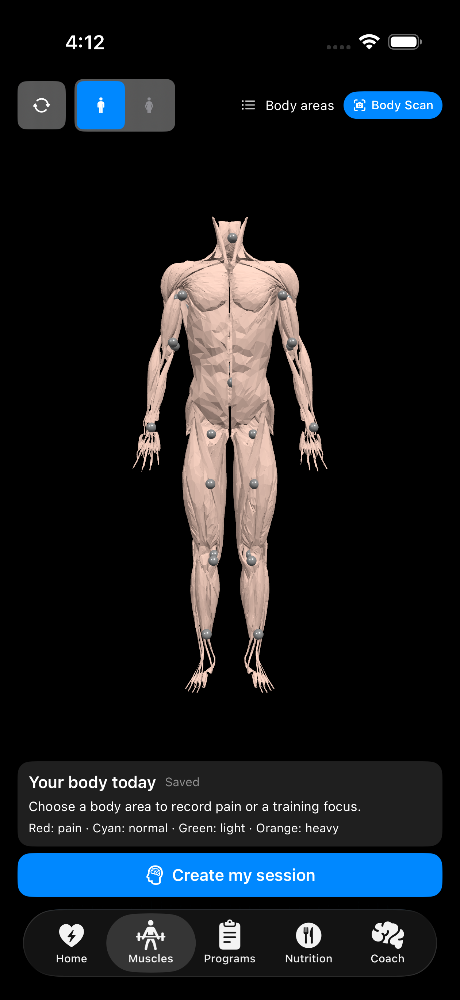
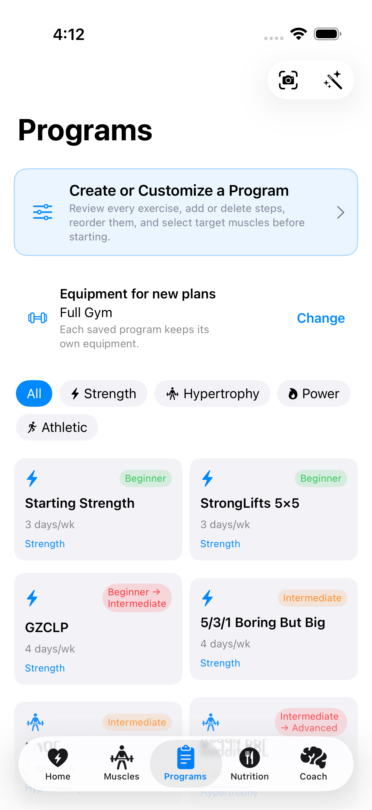
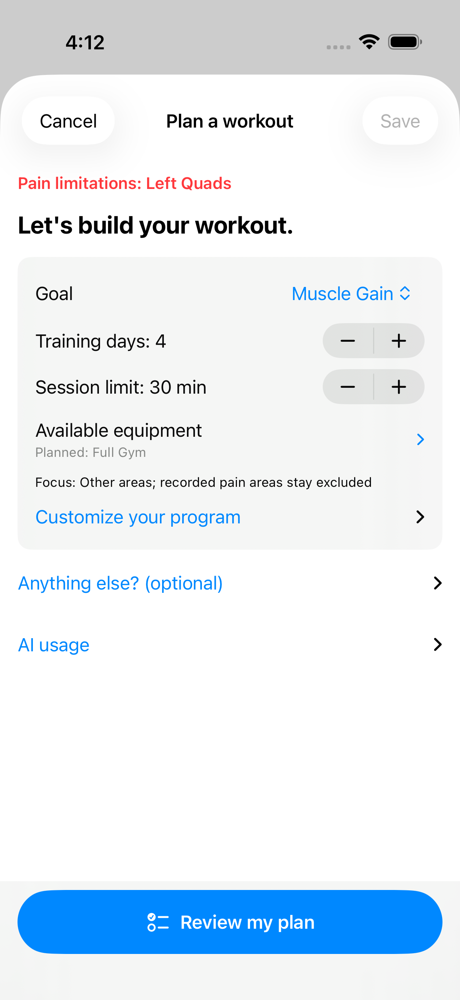
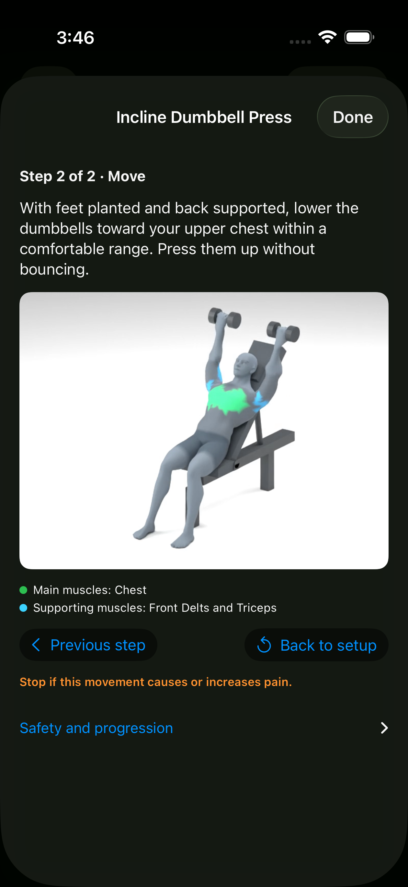
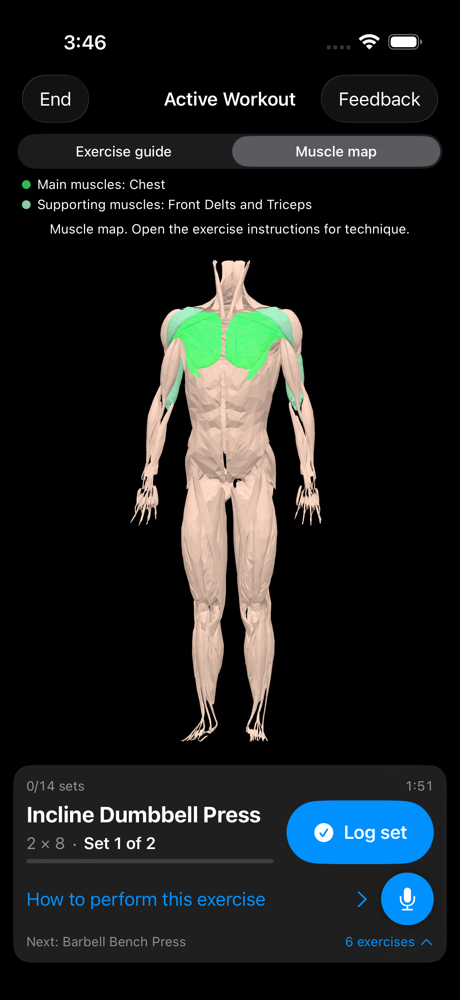
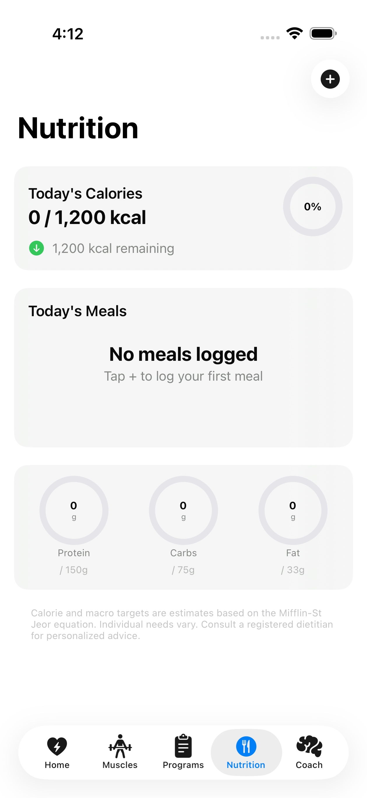

# PrismCoach user guide

> **Release preview — October 20, 2026.** These screenshots show the unreleased 1.2.9 (86) iPhone candidate in the iOS 26.5 simulator with demonstration data. The App Store version may differ. This guide does not announce release availability. The iPhone candidate requires iOS 18 or later.

PrismCoach is a strength, recovery, workout, and nutrition companion for iPhone and iPad, with an optional Apple Watch app. It brings readiness information, muscle status, training programs, meal logging, and AI-assisted coaching into one app.

> PrismCoach provides general fitness information, not medical advice. Recovery scores and AI suggestions are estimates. Stop exercising and seek appropriate medical help if you experience pain, dizziness, shortness of breath, or another concerning symptom.

## First-time setup

1. Open PrismCoach and read the **Health & Safety** notice.
2. Review **Privacy & AI** and choose either the data-sharing option or **On-Device AI Only**.
3. Follow the welcome steps to choose your goal and training preferences. At **Plan your first workout**, choose your available equipment and answer the pain question.
4. Choose **Plan my first workout** to continue planning. If you report pain, mark the affected body areas first. **Explore app** lets you browse; when pain has been selected, that action is labelled **Mark pain on body map** instead.
5. After setup, use your profile to review or change your training information. Connect Apple Health if you want to use permitted health and workout data; you control those permissions in Apple Health and iOS Settings.
6. If you use Apple Watch, install or enable the companion app from the Watch app on your iPhone.

Some features require a supported device, an active plan, Apple Health data, or a network connection. The app shows the current availability before you start a restricted workflow.

## Home and readiness

The **Home** tab summarizes the information that is most useful before a workout:

- **Body Battery** shows a readiness estimate when enough permitted Apple Health data is available.
- **Workout streak** and **Weekly Adherence** show recent consistency against your training-day target.
- **Muscle Status** identifies recovery information recorded by the app.
- **Apple HealthKit** shows whether the integration is connected and displays the health values available to PrismCoach.

If Apple Health is not connected or does not contain enough applicable data, PrismCoach displays an unavailable state instead of inventing a readiness score.

## Muscle status and body map

Use **Muscles** to review or change the status of body areas before selecting a workout.

1. Open **Muscles**.
2. Rotate the body model or switch the body view as needed.
3. Tap a body area to review its status.
4. Review the selected focus and recorded pain in **Your body today**.
5. Use **Create my session** to carry that context into planning. Clearing training focus keeps pain limitations recorded; use the explicit pain-resolution action only when appropriate.

Treat a pain or limitation selection as planning context only. It is not a diagnosis and does not determine whether an exercise is medically safe.

## Training programs and workouts

The **Programs** tab lists available templates and program-building tools.

- Filter templates by the training categories shown on screen.
- Open a template to review its schedule and exercises before starting.
- Use **Create or Customize a Program** to review exercises, add or remove steps, reorder them, and confirm target muscles.
- Start a workout from the reviewed program and record the sets and values requested by the active-workout screen.
- Review generated or suggested content before following it, particularly when you have an injury, limitation, or medical condition.

The templates and availability shown in the app are the current source of truth; they can change as the catalog and plan offerings evolve.

*This example keeps the recorded pain visible while the user reviews the goal, schedule and equipment. It does not recommend training the painful area.*

## Exercise guide and illustrated steps

After starting a reviewed program, the active-workout screen keeps the current exercise, prescribed sets and repetitions, **Log set**, and **How to perform this exercise** together.

1. Select **Exercise guide** to see the available movement preview and equipment.
2. Use **Play preview** or **Pause preview** to control playback. These controls do not advance or record a set.
3. Read **Main muscles** and, where present, **Supporting muscles**. The motion preview uses green for main muscles and blue for supporting muscles; the separate anatomical map uses its own labelled legend. Highlights illustrate intended roles, not measured activation or recovery.
4. Open **How to perform this exercise** for illustrated instructions. Each authored step has its matching picture. Use **Next step**, **Previous step**, or **Back to setup** without waiting for automatic page changes.
5. Tap **Done** to return, then **Log set** when you have completed the actual set.

**Muscle map** is a separate anatomical reference; it is not the technique demonstration. Some regions are hidden naturally by the viewing angle or equipment. Demonstration availability depends on the exercise.

## Nutrition

Use **Nutrition** to record meals and compare the day with the targets shown in the app.

1. Open **Nutrition**.
2. Tap **+** to add a meal.
3. Review the meal name and nutrition values before saving.
4. Use the calorie and macro rings as a daily summary.
5. Remove an incorrect entry from the meal list and add the corrected information.

Calorie and macro targets are estimates. Individual needs vary; consult a registered dietitian or another qualified professional for personalized nutrition advice.

## AI Coach

Open the **Coach** tab to reach the **AI Coach** screen. Start with **Plan a workout** or a suggested question. **More ideas** expands additional questions; **Coach details** expands optional context and access information. Text and voice input let you add detail when needed.

- Choose a suggested question or type your own request.
- Use the microphone when voice input is available and permitted.
- Turn spoken replies on or off with the audio control.
- Use the clear-history control when you deliberately want to start over.
- If the coach produces a training program, review and edit it before saving or starting it.

AI responses can be incomplete or wrong. Do not use AI Coach for diagnosis, emergency decisions, or instructions that replace a qualified medical or fitness professional.

Free users can explore coaching with recurring AI and scan allowances. Pro offers higher cloud allowances and additional access. Open the allowance details in the app to check the current limit and renewal state; this guide does not promise a fixed quota or response time.

## Optional camera tools

Camera tools depend on device support, permissions, the selected AI privacy mode, network access where required, and the remaining allowance.

- **Body Scan** lets you select or take a full-body photo and review the pose overlay used to align the body model.
- **Equipment Scan** classifies a photo you deliberately submit so the app can tailor equipment choices.

Review the detected equipment and correct the list before applying it. If recognition is unavailable, choose equipment manually and continue planning.

The **Privacy & AI** screen explains which camera information stays on the device and which submitted image may be processed by a server. Review that disclosure before using a camera tool. **On-Device AI Only** disables server-based equipment photo recognition; manual equipment choices remain available.

## Apple Watch companion

The Watch app provides swipeable pages for readiness, muscle status, workout logging, AI Coach, the CNS tap test, and settings. Availability depends on the connected iPhone, Watch permissions, plan, and network state.

The Watch dashboard is designed for a quick readiness check. Swipe between pages to reach the other functions, and confirm that the latest phone data has synchronized before relying on the displayed values.

## Profile, settings, and purchases

Open the profile button from Home to review your training profile and available Apple Health values. From the profile, open **Settings** to manage:

- the current plan and **Restore Purchases**;
- Apple Health and AI privacy preferences;
- AI Coach language;
- workout music options when available;
- optional cycle-tracking preferences when included with the current plan;
- app information and support links.

Subscription terms and current prices are shown by Apple in the in-app purchase sheet. Use **Restore Purchases** after reinstalling the app or moving to another device with the same Apple Account.

## Troubleshooting

### Body Battery says it needs health data

Confirm that Apple Health access is enabled for PrismCoach and that the applicable data exists. Permission alone does not guarantee that a score can be calculated.

### An AI allowance is used up or unavailable

Check the allowance details for renewal information. Free access renews automatically; Pro has higher allowances. If the service is unavailable, retry after reconnecting. Upgrading does not repair a network or recognition outage. For a previous Apple purchase, use **Restore Purchases** in Settings.

### A program says review is required

Open **Review Program** and read the flagged goal, focus, pain, equipment or movement-position issue. Check the specific explanation before changing the plan. Do not clear a real pain limitation just to make a program start.

### An equipment scan fails

Check camera permission, the AI privacy mode, connection and available allowance. You can choose equipment manually and continue planning. If capture fails, try choosing a photo or entering equipment manually.

### Apple Watch information is stale

Open PrismCoach on both devices, keep Bluetooth and Wi-Fi available, and allow the sync to complete. Check the Watch and Apple Health permissions if values remain unavailable.

### AI Coach is unavailable

Check the selected AI privacy mode, plan access, network state, and device support shown in the app. A network may be required for some requests even when other coaching paths are available on-device.

## Privacy and control

PrismCoach asks for health/safety acknowledgement and AI data preferences on first launch. You can choose on-device-only AI or allow the server-assisted option described in the app. Apple Health permissions remain under your control, and optional equipment photos are sent only after you choose the scan action.

For the latest data-handling terms, use the Privacy Policy link in PrismCoach or visit [Synalux Privacy](https://synalux.ai/legal/privacy).
